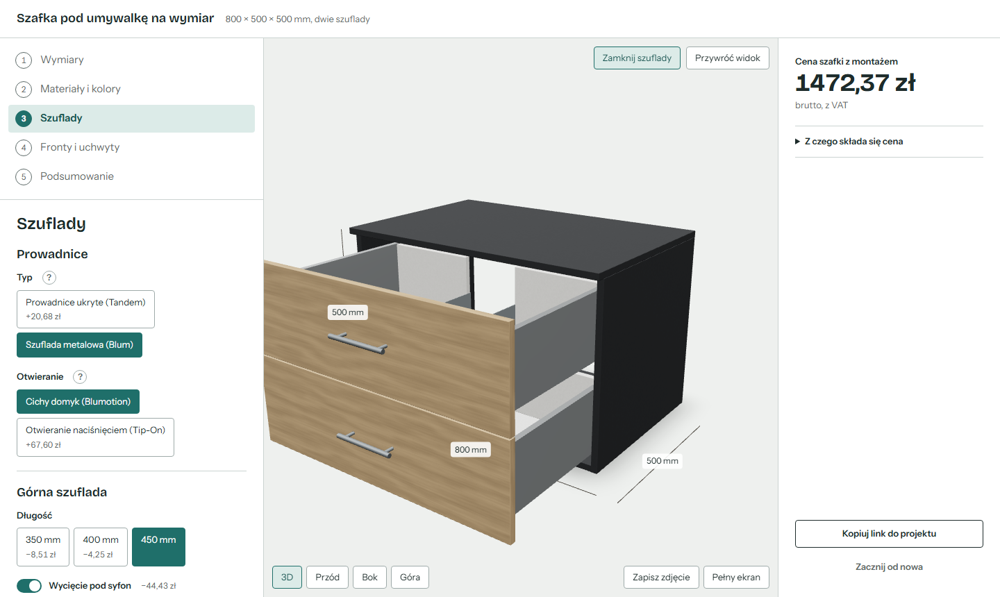

# Bathroom Vanity Configurator

[](https://github.com/SebastianDaszewski/bathroom-cabinet-configurator/actions/workflows/ci.yml)

A configurator for a made-to-measure, wall-hung bathroom vanity with two drawers
and a countertop for a vessel basin. The customer sets dimensions, materials,
drawers, fronts and handles; the app shows a live 3D model, a cost-based price
with what every choice adds, and a production cut list for the workshop.

**Live demo:** https://bathroom-cabinet-configurator.vercel.app



The UI is in Polish (the target market); code and documentation are in English.

## What is not trivial here

- **A rule engine, not form validation.** 14 rules (R1–R14) keep any
  combination buildable: drawer lengths follow the depth, handle spacing follows
  the width, push-to-open removes handles, a countertop never exceeds one board.
  Invalid input is corrected, never rejected, and every correction is explained.
- **One model for 3D, price and production.** `buildPanels(config)` returns
  every physical board with its size, position, edge banding, grain direction
  and holes. The 3D view, the price and the cut list are all derived from it, so
  they cannot disagree.
- **Cost-based pricing.** Boards by area and decor, edge banding by length,
  hardware, machining and labour, calibrated to market prices. The price change
  next to each option is computed by pricing the configuration with and without
  it, so side effects of the rules are included.
- **Real geometry.** Holes and cut-outs are cut into the panels, drawers open,
  textures follow the grain direction of each board, and the scene renders only
  when something changes.
- **Tested like a library.** 387 unit tests (100 % line coverage of the domain),
  invariant tests over extreme configurations, and Playwright smoke tests on
  desktop and mobile — all in CI with lint, types and an unused-code check.

## Features

- Dimensions with a countertop: thickening, left / right / front extensions.
- Board type and decor for the carcass, fronts, drawer boxes and drawer bottoms;
  grain direction and continuous grain across both fronts.
- Concealed or metal-box runners, soft-close or push-to-open, three drawer
  lengths, a siphon cut-out of configurable size and position.
- Plain, milled-grip or edge-handle fronts; single or double handle drilling.
- 3D view: camera presets, drawers open on click, PNG snapshot with dimensions,
  fullscreen.
- Summary with the price of every choice, a cut list and its CSV export, an
  inquiry form that opens the mail client, sharing by link.

## Documentation

| Document                                     | For                                               |
| -------------------------------------------- | ------------------------------------------------- |
| [docs/architecture.md](docs/architecture.md) | Layers, data flow, how to extend it               |
| [docs/spec.md](docs/spec.md)                 | Parameters, rules, panels, pricing                |
| [docs/progress.md](docs/progress.md)         | Milestones and the decisions behind them          |
| [docs/ai-workflow.md](docs/ai-workflow.md)   | How the AI agent was planned, checked and limited |
| [CLAUDE.md](CLAUDE.md)                       | Rules the agent follows in this repository        |

## Running locally

Requires Node 22+ and pnpm 10.

```bash
pnpm install
pnpm dev            # http://localhost:5173
```

| Command              | What it does                                   |
| -------------------- | ---------------------------------------------- |
| `pnpm test`          | Unit tests (Vitest)                            |
| `pnpm test:coverage` | Unit tests with coverage thresholds            |
| `pnpm test:e2e`      | Smoke tests (Playwright) on desktop and 375 px |
| `pnpm typecheck`     | TypeScript, strict                             |
| `pnpm lint`          | oxlint, including the layer boundaries         |
| `pnpm knip`          | Unused files, exports and dependencies         |
| `pnpm format`        | Prettier                                       |
| `pnpm build`         | Production build                               |

The first `pnpm test:e2e` needs a browser: `pnpm exec playwright install chromium`.

## Stack

Vite · React 19 · TypeScript (strict) · Three.js with React Three Fiber and drei ·
Zustand · Zod · Vitest · Playwright · oxlint · Prettier · knip · GitHub Actions ·
Vercel

## Configuration

- Prices and rates: `src/domain/pricing.config.ts`
- Construction values (board thickness, gaps, clearances): `src/domain/constants.ts`
- Decors and boards: `src/domain/catalog.ts`
- Inquiry e-mail address: `INQUIRY_EMAIL` in `src/features/inquiry/inquiry.ts`
