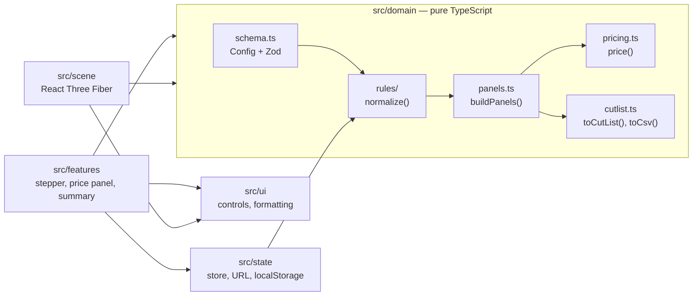

# Architecture

How the code is organised, why, and how to extend it without breaking the
model. The functional rules are in [spec.md](spec.md).

## Layers



| Layer          | Owns                                                       | May import        |
| -------------- | ---------------------------------------------------------- | ----------------- |
| `src/domain`   | Config, rules, panels, pricing, cut list, catalogue        | nothing but Zod   |
| `src/state`    | Zustand store, URL encoding, localStorage                  | domain            |
| `src/scene`    | 3D rendering of `Panel[]`, pure geometry/texture helpers   | domain, ui        |
| `src/features` | Steps, price panel, summary, inquiry, sharing              | domain, state, ui |
| `src/ui`       | Generic controls (fields, dialog), number and price format | domain types only |

The two most important boundaries are enforced by oxlint
(`no-restricted-imports` in `.oxlintrc.json`): the domain cannot import React,
Three.js, Zustand or any upper layer, and the scene cannot read the store or
the features. Breaking them fails `pnpm lint` and CI.

## Data flow

```
user input
  → store.update(patch)
  → normalize(config)         rules R1–R14, returns { config, adjustments }
  → buildPanels(config)       one Panel per physical piece, in mm
  → scene  |  price  |  cut list / CSV
```

- **One source of truth for geometry.** The 3D view, the price and the cut list
  are all computed from the same `Panel[]`, so the model the customer sees and
  the parts the workshop cuts cannot diverge.
- **Rules never throw.** Every rule takes any schema-valid config and returns a
  valid one plus a list of adjustments with a Polish explanation; the UI shows
  them. `normalize()` is idempotent (tested over a grid of extreme configs).
- **The URL is the state.** Only fields that differ from the defaults are
  written; anything read back goes through `parseConfig` and `normalize`, so a
  broken or old link still opens.
- **Money is integer grosze.** The margin is applied per line, and the total is
  the sum of the lines, so the breakdown always adds up.

## Extending the configurator

### Add a decor

1. Add an entry to `DECORS` in `src/domain/catalog.ts` (`id`, `name`, `code`,
   `color`, `finish`, `boards`, `pricePerM2Modifier`).
2. Nothing else: R9 checks it against the board, the pickers list it, the price
   and the 3D texture use it. `catalog.test.ts` guards ids and colours.

### Add a configuration option

1. `src/domain/schema.ts` — the enum or number, `ConfigSchema`, `DEFAULT_CONFIG`
   (and `LIMITS` for numbers, which R1 then clamps).
2. A rule in `src/domain/rules/` if the option constrains or depends on others.
3. `panels.ts` if it changes geometry; `pricing.config.ts` / `pricing.ts` if it
   costs something.
4. Polish labels and the "?" description in `src/features/labels.ts`.
5. A control in the matching step, with `note: priceNote(config, patch)` so the
   customer sees what it costs.
6. A row in `src/features/summary/summary.ts` with its `reset` patch.

URL sharing and localStorage pick the new field up automatically.

### Add a rule

1. Write a `Rule` (`(config) => { config, adjustments }`) in `src/domain/rules/`
   with a test next to it.
2. Register it in `RULES` in `rules/index.ts`; the order matters when it reads
   values that another rule corrects.
3. Add its id to `RuleId` and describe it in `spec.md` §3.
4. The idempotency grid in `rules/index.test.ts` must still pass.

### Add a panel

1. Build it with `place()` in `src/domain/panels.ts` (length, width, thickness,
   axes, minimum corner, edges).
2. It appears in the 3D view, the cut list and the price on its own. The
   invariant tests in `panels.test.ts` fail if it overlaps another panel or
   leaves the cabinet.
3. Hardware that is not cut from board (handles, metal sides, trays) belongs in
   `src/scene/hardware.ts` and is priced in `pricing.ts`.

### Change a price or a construction value

- Rates: `src/domain/pricing.config.ts`. The calibration tests check price
  ranges, so they fail only if the result leaves the target market range.
- Construction values (board thickness, gaps, clearances, margins):
  `src/domain/constants.ts`.

## Testing strategy

| Level       | What                                                            | Where                                   |
| ----------- | --------------------------------------------------------------- | --------------------------------------- |
| Unit        | Every rule, panels, pricing, cut list, URL, store, scene maths  | `src/**/*.test.ts`                      |
| Invariants  | Panel geometry over 72 extreme configs; `normalize` idempotency | `panels.test.ts`, `rules/index.test.ts` |
| Calibration | Price ranges, not exact amounts                                 | `pricing.test.ts`                       |
| End-to-end  | Smoke tests on desktop and 375 px                               | `e2e/smoke.spec.ts`                     |

Coverage thresholds for the logic (100 % lines in `src/domain`, 90 % overall)
are checked by `pnpm test:coverage` in CI. React components and canvas code are
covered by the Playwright tests instead.
